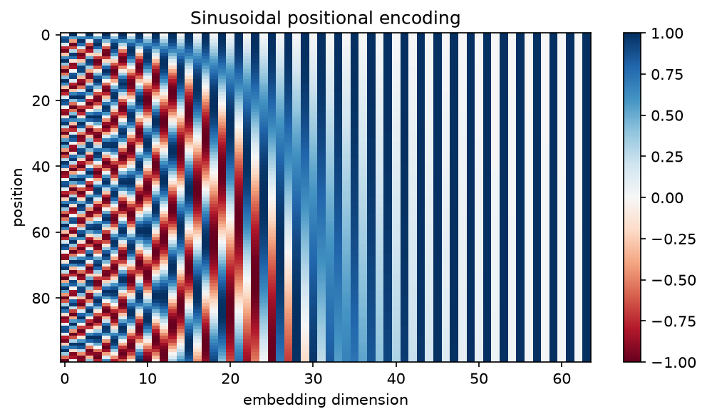
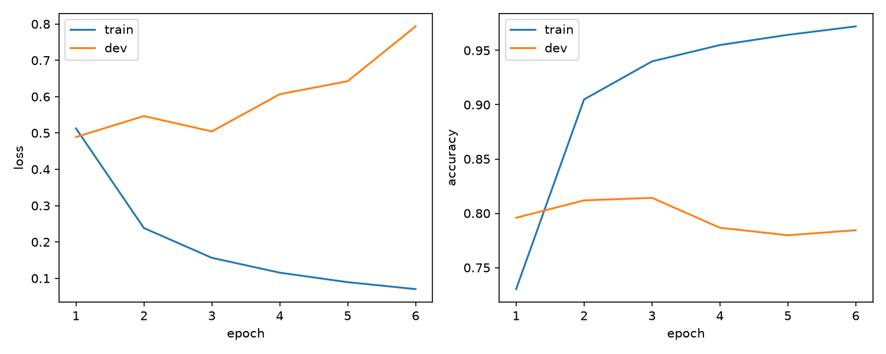
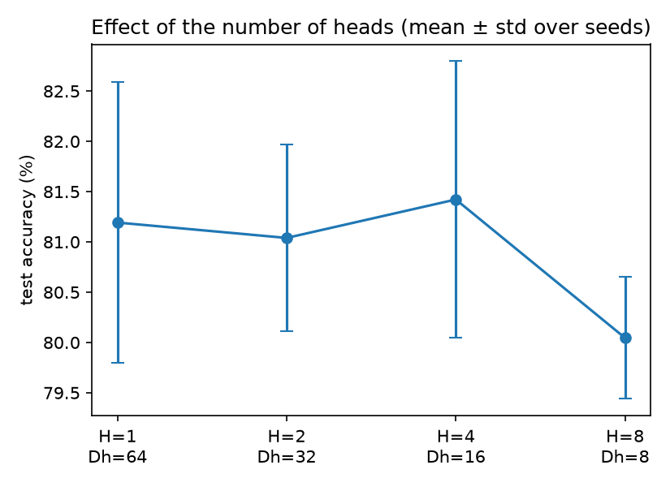

# 🤖 Transformers Fundamentals

> A from-scratch PyTorch implementation of the core Transformer building blocks, trained on SST-2 sentiment classification, compared head-to-head with a pretrained Hugging Face model, and probed with controlled experiments on attention heads, positional encoding, and sequence length.

-blue)


---

## 📑 Table of Contents

- [🎯 Goals](#-goals)
- [🗺️ Roadmap](#️-roadmap)
- [🗂️ Project Structure](#️-project-structure)
- [⚙️ Setup](#️-setup)
- [🚀 Usage](#-usage)
- [🧱 Part 1 — Implemented Components](#-part-1--implemented-components)
- [🧠 Part 2 — Self-Attention](#-part-2--self-attention)
- [🧩 Part 3 — Multi-Head Attention](#-part-3--multi-head-attention)
- [🏗️ Part 4 — Transformer Encoder Block](#️-part-4--transformer-encoder-block)
- [🤗 Part 5 — Training and Hugging Face](#-part-5--training-and-hugging-face)
- [⚖️ Part 6 — Toy Model vs. Real Transformer](#️-part-6--toy-model-vs-real-transformer)
- [🧪 Part 7 — Experiments](#-part-7--experiments)
- [✅ Testing](#-testing)
- [📚 Key Concepts Cheat Sheet](#-key-concepts-cheat-sheet)
- [⚠️ Limitations](#️-limitations)
- [📖 References](#-references)

---

## 🎯 Goals

The goal is **understanding the Transformer architecture**, not just running a pretrained model.

- 🔧 Implement each component by hand, writing every `forward()` and tracking every tensor shape
- 🔢 Understand self-attention through a small numerical example
- 🏋️ Train the model on real data and measure it honestly
- 🤗 Run a pretrained Hugging Face classifier **without** `pipeline()` (`AutoTokenizer` + `AutoModelForSequenceClassification`)
- 🔬 Run experiments that show *why* the design choices matter

**Out of scope:** LangChain, LangGraph, agents, and building a ChatGPT-like system.

---

## 🗺️ Roadmap

| Phase | Topic | Status |
|:---:|---|:---:|
| 0 | Project skeleton and environment | ✅ |
| 1 | Attention math demo (numerical example) | ✅ |
| 2 | Embedding, positional encoding, scaled dot-product attention | ✅ |
| 3 | Multi-head attention | ✅ |
| 4 | Feed-forward, LayerNorm, encoder block, classifier | ✅ |
| 5 | Training the from-scratch model on SST-2 | ✅ |
| 6 | Hugging Face inference and comparison | ✅ |
| 7 | Three experiments (heads, positional encoding, sequence length) | ✅ see [Part 7](#-part-7--experiments) |
| 8 | Final README and write-up | ✅ |

---

## 🗂️ Project Structure

```text
transformers-project/
├── README.md
├── requirements.txt
├── pytest.ini
│
├── src/
│   ├── embeddings.py              # Token embedding (scaled by sqrt(d_model))
│   ├── positional_encoding.py     # Sinusoidal positional encoding
│   ├── attention.py               # Scaled dot-product attention + padding/causal masks
│   ├── multi_head_attention.py    # Multi-head attention (self- and cross-attention)
│   ├── feed_forward.py            # Position-wise feed-forward network
│   ├── layer_norm.py              # LayerNorm written from scratch
│   ├── transformer_block.py       # Encoder block (Post-LN or Pre-LN)
│   ├── model.py                   # Transformer classifier
│   ├── tokenizer.py               # Word-level tokenizer
│   ├── data.py                    # Dataset, collator, SST-2 loading and splits
│   ├── metrics.py                 # Accuracy / precision / recall / F1 by hand
│   └── compare.py                 # Paired comparison helpers (sign test, label check)
│
├── experiments/
│   ├── common.py                  # Shared training/statistics helpers
│   ├── heads.py                   # Experiment 1: number of heads
│   ├── positional_encoding.py     # Experiment 2: no positional encoding
│   ├── sequence_length.py         # Experiment 3: cost vs. sequence length
│   └── make_report.py             # Collects the JSON results into one Markdown report
│
├── reports/                       # Demo scripts, plots, JSON results
├── train.py                       # Train the from-scratch model
├── evaluate.py                    # Evaluate a checkpoint, classify custom sentences
├── hf_inference.py                # Hugging Face model without pipeline() + comparison
│
└── tests/                         # pytest suite (no network needed)
```

---

## ⚙️ Setup

```bash
# 1. Create and activate a virtual environment
python -m venv .venv
.venv\Scripts\activate             # macOS/Linux: source .venv/bin/activate

# 2. Install PyTorch (CPU build) and the remaining dependencies
pip install torch --index-url https://download.pytorch.org/whl/cpu
pip install -r requirements.txt

# 3. Verify the installation
pytest
```

Developed and run on CPU only (Windows, Python 3.14). Pinned versions of the exact environment: `requirements.lock.txt`.

---

## 🚀 Usage

```bash
# Phase demos (numerical output, no training)
python reports/phase1_attention_demo.py
python reports/phase2_pe_demo.py
python reports/phase3_mha_demo.py
python reports/phase4_block_demo.py
python reports/phase8_decoder_demo.py

# Train the from-scratch model on SST-2, then evaluate it
python train.py
python evaluate.py --text "a wonderful and moving film" --text "not bad at all"

# Hugging Face model (no pipeline) and head-to-head comparison
python hf_inference.py

# Experiments (run from the project root, with -m)
python -m experiments.sequence_length
python -m experiments.positional_encoding --skip-sst2
python -m experiments.heads
python -m experiments.make_report          # writes reports/experiments_report.md
```

---

## 🧱 Part 1 — Implemented Components

| Component | File | What it does |
|---|---|---|
| Token embedding | `src/embeddings.py` | `nn.Embedding` scaled by √D, init std D^-0.5, zeroed padding row |
| Positional encoding | `src/positional_encoding.py` | Sinusoidal, stored as a buffer (no parameters) |
| Scaled dot-product attention | `src/attention.py` | `softmax(QKᵀ/√dₖ)V` with boolean masks (`True` = may attend) |
| Multi-head attention | `src/multi_head_attention.py` | Split heads, attend, concatenate, output projection |
| Feed-forward network | `src/feed_forward.py` | `Linear(D→d_ff)`, ReLU/GELU, `Linear(d_ff→D)` |
| Layer normalization | `src/layer_norm.py` | Per-token normalization with learnable γ and β |
| Residual connections | `src/transformer_block.py` | `x + Sublayer(x)`, Post-LN (default) or Pre-LN |
| Encoder block and classifier | `src/transformer_block.py`, `src/model.py` | Stacked blocks, masked mean pooling, linear head |

Every module is checked against a PyTorch reference in the tests (`F.scaled_dot_product_attention`, `nn.MultiheadAttention`, `nn.LayerNorm`). The reference functions are used **only in tests**, never inside the model.

---

## 🧠 Part 2 — Self-Attention

### The pipeline

```text
X  ──►  Q, K, V  ──►  QKᵀ  ──►  ÷ √dₖ  ──►  softmax  ──►  weights  ──►  weights · V
```

$$
\text{Attention}(Q, K, V) = \text{softmax}\!\left(\frac{QK^\top}{\sqrt{d_k}}\right)V
$$

### 🔍 Why each piece exists

| Piece | Why it is there |
|---|---|
| **Q, K, V projections** | *Matching* (which tokens are related) and *content* (what is passed on) are different jobs. Separate projections let the model learn asymmetric relations. |
| **QKᵀ** | Each query is compared with every key via a dot product, giving a `[T, T]` similarity matrix. The transpose makes shapes line up: `[T, dₖ] @ [dₖ, T] → [T, T]`. |
| **÷ √dₖ** | For random unit-variance vectors the dot product has variance `dₖ`. Without scaling, scores grow with `dₖ`, softmax saturates (almost one-hot) and gradients vanish. |
| **Softmax (dim=-1)** | Turns each row of scores into positive weights that sum to 1: a distribution over the tokens each query attends to. |
| **· V** | Each output is a weighted average of all value vectors, so every token gathers context from the sequence. |

### 🔢 Numerical example

Simplification: no projections (`Q = K = V = X`) and `dₖ = 2`. Four tokens:

```text
t1 = [ 1,  0]    t2 = [ 0,  1]    t3 = [ 1,  1]    t4 = [ 1, -1]
```

**Step 1 — scores `QKᵀ`:**

```text
       t1  t2  t3  t4
t1  [   1,  0,  1,  1 ]
t2  [   0,  1,  1, -1 ]
t3  [   1,  1,  2,  0 ]
t4  [   1, -1,  0,  2 ]
```

**Step 2 — scaling by `√2 ≈ 1.414`.** Row t1 becomes `[0.707, 0, 0.707, 0.707]`.

**Step 3 — softmax on row t1:**

```text
weights(t1) = [0.286, 0.141, 0.286, 0.286]      # sums to 1
```

**Step 4 — weighted sum of V:**

```text
out(t1) = 0.286·[1,0] + 0.141·[0,1] + 0.286·[1,1] + 0.286·[1,-1]  ≈  [0.859, 0.141]
```

💡 t1 attends least to t2 (orthogonal to it) and equally to the three tokens with a positive dot product.

### 🎚️ Why √dₖ matters (empirical)

`reports/phase1_attention_demo.py` (Part B) compares the average maximum softmax weight with and without scaling.

| dₖ | Score std (√dₖ) | Avg max weight (unscaled) | Avg max weight (scaled) |
|:---:|:---:|:---:|:---:|
| 4 | 2.02 (2.00) | 0.498 | 0.308 |
| 64 | 7.99 (8.00) | 0.866 | 0.317 |
| 512 | 22.47 (22.63) | 0.952 | 0.319 |

Setup: 2,000 random trials, one query against 10 keys, entries with unit variance, one seed. The score standard deviation grows like √dₖ, so without scaling the softmax becomes almost one-hot as dₖ grows (average max weight 0.95 at dₖ=512, where gradients vanish), while with scaling it stays around 0.31 regardless of dₖ.

### 🔀 Self-attention ignores order

Permuting the input tokens only permutes the outputs (permutation equivariance, verified in the demo and in a test). Without extra information the model cannot tell `"dog bites man"` from `"man bites dog"`. This is why **positional encoding** is required.

### 🌊 Positional encoding



*Rows are positions, columns are embedding dimensions. Left dimensions oscillate quickly (they separate nearby positions); right dimensions change slowly (they separate distant positions). Even/odd columns alternate between sin and cos.* Adding the encoding breaks the permutation symmetry (verified in `reports/phase2_pe_demo.py`).

---

## 🧩 Part 3 — Multi-Head Attention

### Tensor shapes (B = batch, T = sequence length, D = model dim, H = heads, Dh = D / H)

| Stage | Shape |
|---|:---:|
| Input | `[B, T, D]` |
| After `W_q`, `W_k`, `W_v` | `[B, T, D]` |
| Split into heads | `[B, H, T, Dh]` |
| Scores / attention weights | `[B, H, T, T]` |
| Per-head output | `[B, H, T, Dh]` |
| Concatenate heads | `[B, T, D]` |
| After output projection `W_o` | `[B, T, D]` |

Splitting is `view(B, T, H, Dh).transpose(1, 2)`; merging is `transpose(1, 2).contiguous().view(B, T, D)` (`contiguous()` is required because `transpose` only changes strides).

### ❓ Design questions

- **Why multiple heads?** Each head works in its own lower-dimensional subspace, so the model can attend to different kinds of relations in parallel.
- **What does each head learn?** Nothing is assigned by design; specialization emerges during training (and some heads end up redundant). With random weights, heads differ but are not specialized.
- **Why concatenate?** Each head produces a `Dh`-dimensional summary; concatenation restores the full `D`-dimensional representation.
- **Why a final projection `W_o`?** Concatenation only places head outputs side by side. `W_o` mixes information *across* heads.

### 💰 What changes with the number of heads? (D=64, T=128, B=1)

| H | Dh | Parameters | Attention-weight elements (B·H·T²) |
|:-:|:-:|---:|---:|
| 1 | 64 | 16,640 | 16,384 |
| 2 | 32 | 16,640 | 32,768 |
| 4 | 16 | 16,640 | 65,536 |
| 8 | 8 | 16,640 | 131,072 |

The parameter count does not depend on H (the projections are `D×D` matrices merely *viewed* as H slices), while the attention-weight memory grows linearly with H because every head builds its own `T×T` matrix. The compute of `QKᵀ` is about `2·B·T²·D`, so H cancels out. A `view`/`transpose` demo with strides is in `reports/phase3_mha_demo.py`.

### 🔁 Self- vs. cross-attention

`MultiHeadAttention.forward(query, key, value, mask)` takes the three inputs separately. For self-attention pass the same tensor three times; for **cross-attention** pass decoder states as `query` and encoder outputs as `key`/`value` (the output then follows the query length, the weights are `[B, H, T_q, T_k]`). Both are covered by tests and by `reports/phase8_decoder_demo.py`. The demo also shows the decoder-style **causal mask**: weights above the diagonal are exactly zero, each row is the encoder row with the future removed and renormalized (the last token, which may see everyone, keeps its full row), and changing the last token leaves all earlier outputs unchanged in the decoder but not in the encoder.

---

## 🏗️ Part 4 — Transformer Encoder Block

```text
Input
  │
  ├──────────────┐
  ▼              │
Multi-Head Self-Attention
  │              │
  ▼              │
 (+) ◄───────────┘   Residual
  │
LayerNorm
  │
  ├──────────────┐
  ▼              │
Feed-Forward Network
  │              │
  ▼              │
 (+) ◄───────────┘   Residual
  │
LayerNorm
  │
Output  [B, T, D]
```

### 🔁 Why residual connections

For `y = x + f(x)` the derivative is `I + ∂f/∂x`: the identity term gives gradients a direct path that no layer can weaken. Measured in `reports/phase4_block_demo.py` (gradient norm at the input of a stack of `Linear + tanh` layers, D=64):

| Depth | No residual | With residual |
|:-----:|:-----------:|:-------------:|
| 5  | 3.4e-01  | 1.2e+01 |
| 20 | 1.2e-04  | 2.4e+01 |
| 50 | 4.5e-12  | 9.6e+01 |

Without residuals the gradient shrinks by roughly a factor of 0.57 per layer here. With residuals it does not vanish (the identity path alone contributes a gradient of norm √64 = 8) and even grows, which is why Transformers pair residuals with LayerNorm. This is a toy stack with one seed: it shows the mechanism, not a property of trained Transformers.

### 📏 Why LayerNorm

It normalizes **each token** over its feature dimension, stabilizing activation scale and training. Example from the demo: an input with mean 5.19 / std 3.05 becomes mean 0.00 / std 1.00. Unlike BatchNorm it does not depend on batch statistics, so it works with variable-length sequences, small batches and padding (a test checks that a token's output does not depend on other samples).

### 🧱 Feed-forward network

`Linear(D→d_ff) → activation → Linear(d_ff→D)` is applied to every position independently ("position-wise"; a test checks it). Attention moves information *between* tokens; the FFN processes each token on its own and adds non-linearity. For `D=64`, `d_ff=256` one block has 49,984 parameters:

| Part | Parameters | Share |
|---|---:|:---:|
| Attention | 16,640 | 33.3% |
| Feed-forward | 33,088 | 66.2% |
| 2 × LayerNorm | 256 | 0.5% |

### 📝 Design choice: Post-LN vs. Pre-LN

The default is **Post-LN** (`LN(x + Sublayer(x))`, as in the original paper and the task diagram). `norm_first=True` switches to Pre-LN (`x + Sublayer(LN(x))`), which keeps a clean residual path and is more stable for deep stacks; it needs a final LayerNorm, which the classifier adds. Training uses learning-rate warmup because Post-LN is sensitive to large early learning rates.

---

## 🤗 Part 5 — Training and Hugging Face

### 5.1 Own model on SST-2

- **Data:** GLUE SST-2 (movie-review sentences, binary sentiment). GLUE hides the test labels, so the validation set is split in half with a fixed seed: **dev** (436 sentences, picks the best epoch) and **test** (436 sentences, reported once). The same split is used for every model.
- **Tokenizer:** word-level, vocabulary built from the training split only (`min_freq=2`, 13,388 entries).
- **Model:** 2 layers, D=128, 4 heads, d_ff=512, Post-LN, masked mean pooling: **2,110,466 parameters** (81% of them are the embedding table).
- **Training:** AdamW (lr 5e-4, weight decay 0.01), linear warmup + decay, gradient clipping 1.0, early stopping (patience 3), best epoch kept by dev accuracy. About 8 minutes per epoch on CPU.



| Epoch | Train acc | Dev loss | Dev acc | Dev F1 |
|:-:|:-:|:-:|:-:|:-:|
| 1 | 73.0% | 0.489 | 79.6% | 0.800 |
| 2 | 90.5% | 0.547 | 81.2% | 0.797 |
| **3** | 94.0% | 0.504 | **81.4%** | 0.817 |
| 4 | 95.5% | 0.607 | 78.7% | 0.790 |
| 5 | 96.4% | 0.643 | 78.0% | 0.788 |
| 6 | 97.2% | 0.793 | 78.4% | 0.786 |

Training accuracy keeps rising while dev accuracy peaks at epoch 3 and then declines: classic overfitting, handled by early stopping. Dev *loss* is lowest at epoch 1 although accuracy is best at epoch 3: the model becomes over-confident on its mistakes, which cross-entropy punishes heavily.

### 5.2 Hugging Face model (no `pipeline()`)

- **Model:** `distilbert/distilbert-base-uncased-finetuned-sst-2-english` (6 layers, D=768, fine-tuned on SST-2), **66,955,010 parameters**
- **Workflow** (`hf_inference.py`): (1) tokenize with WordPiece (`[CLS]`/`[SEP]`), (2) encode to `input_ids` and `attention_mask` with dynamic padding, (3) inference with `model.eval()` and `torch.inference_mode()` → logits `[B, 2]`, (4) softmax + argmax, with the label mapping verified against `model.config.id2label`, (5) evaluation with the same `binary_metrics` as our model.

Example of what the tokenizer does:

```text
'an unwatchable, unbelievably tedious mess'
[CLS] an un ##watch ##able , un ##bel ##ie ##va ##bly ted ##ious mess [SEP]   (T = 15)
```

### 5.3 Results (SST-2 test split, 436 sentences)

| Model | Accuracy | Precision | Recall | F1 | Parameters | Inference time |
|---|:---:|:---:|:---:|:---:|---:|---:|
| Majority-class baseline | 53.0% | – | – | – | – | – |
| Own from-scratch model | 82.1% | 0.826 | 0.840 | 0.833 | 2,110,466 | 0.8 s |
| DistilBERT (pretrained) | **92.2%** | 0.919 | 0.935 | 0.927 | 66,955,010 | 37.0 s |

Confusion matrices (rows = true, columns = predicted):

| Own model | pred neg | pred pos | | DistilBERT | pred neg | pred pos |
|---|:---:|:---:|---|---|:---:|:---:|
| **true neg** | 164 | 41 | | **true neg** | 186 | 19 |
| **true pos** | 37 | 194 | | **true pos** | 15 | 216 |

**Head-to-head on identical sentences:** both correct 346, only DistilBERT correct 56, only own model correct 12, both wrong 22. Exact sign test on the 68 disagreements: p = 6.2e-08. The paired accuracy gap is 10.1 points (approximate 95% CI 6.5 to 13.7). With 436 sentences one accuracy has a standard error of roughly ±1.3 to ±1.9 points. Timings are single CPU runs and only indicate orders of magnitude (about 46x).

### 5.4 Error analysis

Based on the first 8 examples shown in each category, so these are observations, not statistics:

- **DistilBERT right, own model wrong:** contrast sentences ("works hard to establish rounded characters, but then has nothing fresh…"), idioms ("now I can't wait…") and rare words.
- **Own model right, DistilBERT wrong:** mostly sentences with several negations or praise followed by criticism; the pretrained model was often *very* confident (p = 0.94 to 1.00) when wrong. Softmax probability is not a calibrated confidence.
- **Both wrong (22 sentences, 5%):** sarcasm, negated negatives ("doesn't bother being cloying") and mixed sentiment.
- **Hand-written probes:** both models handle "a wonderful and moving film" and "a dull, lifeless mess"; our model rates "not bad at all" as negative (p_pos = 0.03) whereas DistilBERT rates it positive (1.00).

---

## ⚖️ Part 6 — Toy Model vs. Real Transformer

### Mapping our components to DistilBERT

| Aspect | This project | DistilBERT |
|---|---|---|
| Embedding | Word-level, trained from scratch | WordPiece (about 30k), **pretrained** |
| Positional information | Sinusoidal (fixed) | Learned |
| D / heads / Dh | 128 / 4 / 32 | 768 / 12 / 64 |
| FFN | 128 → 512, ReLU | 768 → 3072, GELU |
| Layers | 2 | 6 |
| LayerNorm placement | Post-LN | Post-LN |
| Sentence representation | Masked mean pooling | `[CLS]` token plus a small head |
| Parameters | 2.1 M | 67 M |

The block design is the same idea; the difference is scale and, above all, **pretraining** (DistilBERT was distilled from BERT, which was pretrained on a huge text corpus, then fine-tuned on SST-2).

### The four questions of the task

| Question | Answer |
|---|---|
| **What does our implementation have?** | Every core block (embedding, positional encoding, multi-head attention, FFN, residual, LayerNorm, masking), tested against PyTorch references, a full training pipeline, and 82.1% test accuracy (29 points above the baseline). |
| **What does it lack?** | Pretraining, subword tokenization, learned positions, scale, mixed precision, optimized attention kernels, regularization tricks, and a decoder. |
| **Why is a production model so much more complex?** | Scale and data (32x more parameters here), stable large-scale training (warmup, schedulers, distributed training), fast serving (batching, caching, quantization), and engineering of the attention kernel itself. In our run DistilBERT is 46x slower per sentence for 10 more points of accuracy. |
| **What separates a toy from a real Transformer?** | Mostly pretraining and scale, not the block design. DistilBERT fixed 56 of our 78 errors, yet was confidently wrong on 12 sentences we got right. |

⚠️ The 10-point gap **cannot be attributed to pretraining alone**: the tokenizer, model size, positional encoding and training recipe also differ. Isolating pretraining would require training DistilBERT's architecture from random weights.

---

## 🧪 Part 7 — Experiments

Experiments 1 and 2 use a smaller model (D=64, 2 layers, d_ff=256) on a 20,000-sentence training subset for 4 epochs, repeated over seeds (a **seed** is the random-number starting point; each configuration is trained several times and reported as mean ± std). Their accuracies are **not comparable** with the 82.1% of the full model: compare the variants only with each other. With 436 test sentences one accuracy has a standard error of about 2 points, so differences smaller than the seed-to-seed std are not established.

The complete tables are generated by `python -m experiments.make_report` into [`reports/experiments_report.md`](reports/experiments_report.md).

### 🔬 Experiment 1 — Number of attention heads

**Setup:** `H ∈ {1, 2, 4, 8}` with D fixed, so `Dh = D / H` shrinks. Parameters are identical for all H, and with the same seed all models start from identical weights.

| H | Dh | Test acc % (mean ± std) | Final train loss | s/epoch |
|:-:|:-:|:-:|:-:|:-:|
| 1 | 64 | 81.2 ± 1.4 | 0.156 | 67 |
| 2 | 32 | 81.0 ± 0.9 | 0.156 | 70 |
| 4 | 16 | 81.4 ± 1.4 | 0.158 | 71 |
| 8 | 8 | 80.0 ± 0.6 | 0.157 | 80 |



Every model has 709,250 parameters (86% of them the embedding table), 3 seeds (0, 1, 2), train loss measured with dropout on. Test accuracies move in steps of 1/436 = 0.23 points, so identical values can appear in different rows. The best-to-worst gap between the means (1.4 points) is not larger than the seed-to-seed std (up to 1.4), and the per-seed differences to H=1 point in different directions, so **no effect of the number of heads is established**. The H=4 row reproduces the "with PE" row of Experiment 2 exactly (81.42, 80.05, 82.80), which confirms that the training pipeline is deterministic for a given seed. Time per epoch rises with H (67 s to 80 s) but with visible noise (66 to 77 s across the three seeds of H=4).

**Analysis:** Changing H from 1 to 8 with D fixed did not produce a measurable change in test accuracy. The means (81.2, 81.0, 81.4, 80.0) differ by at most 1.4 points, which is not larger than the seed-to-seed standard deviation (up to 1.4) or the ±2-point standard error of a 436-sentence test set, and the per-seed differences to H=1 point in different directions. H=8 (Dh=8) tends to be slightly worse (−1.15 points on average over three pairs), which three seeds cannot confirm. The final training loss was the same for all H (0.156 to 0.158), so the head count did not change how well the model fits the training data. The parameter count is identical (709,250) because the projections are D×D matrices that are only viewed as H slices; what changes is Dh = D/H (64 down to 8), the number of T×T attention matrices (linear in H) and, slightly, the time per epoch (67 s to 80 s, with visible noise). A plausible reason for the missing effect is that SST-2 is mostly lexical and the model is small and shallow, so diverse attention patterns bring little; with Dh as small as 8 each head works in a very low-dimensional subspace, which may explain the weak tendency at H=8. These explanations were not tested. Detecting differences of one or two points would need more seeds and a larger test set.

### 🔬 Experiment 2 — Removing positional encoding

**Why it must matter:** attention is permutation-equivariant and mean pooling is permutation-invariant, so without positional encoding the model cannot see word order at all (proved by tests: shuffling the tokens leaves the output unchanged).

Two tests: (a) SST-2, plus the same test set with the words of each sentence shuffled; (b) a **synthetic task**: random filler tokens plus one `A` and one `B` marker, label = "A comes before B". Swapping the two markers flips the label but keeps the bag of tokens identical, so a model that cannot see order is exactly at chance.

| Task | Variant | Test acc % (mean ± std) | Extra |
|---|---|:-:|:-:|
| Synthetic A-before-B | with PE | 100.0 ± 0.0 | swap diff 9.98e-01 |
| Synthetic A-before-B | without PE | 49.2 ± 0.9 (chance = 50%) | swap diff 1.19e-08 |
| SST-2 | with PE | 81.4 ± 1.4 | shuffled-words acc 81.3 |
| SST-2 | without PE | 80.9 ± 0.9 | shuffled-words acc 80.9 |

**Analysis:** On the synthetic task (label = A before B) the model with positional encoding reached 100% on all three seeds, while the model without it stayed at chance (49.2 ± 0.9%, within the ±1.6-point standard error of a 1000-example test set). This is not a training failure: swapping A and B flips the label but keeps the bag of tokens identical, and without positional encoding the output for the original and the swapped input differs by only about 1e-8 (float noise), against 0.998 with it. Self-attention is permutation-equivariant and mean pooling is permutation-invariant, so the model is blind to order. Both variants share the same initial weights and training budget (positional encoding has no parameters), so the difference is attributable to positional encoding alone. On SST-2 the effect was much smaller: 81.4 ± 1.4% with versus 80.9 ± 0.9% without, a 0.5-point difference below the seed-to-seed std, so no effect is established. Shuffling the words of the test sentences changed the accuracy of the model with positional encoding by only 0.15 points (81.4 to 81.3) and left the model without it exactly unchanged, as it must. At this scale the model thus behaves essentially like a bag-of-words classifier: sentiment is carried mostly by individual words. Word order matters when the task depends on it (for example negation), but such sentences are likely a minority here, and a 436-sentence test set cannot resolve a small effect. These explanations were not tested directly.

### 🔬 Experiment 3 — Sequence length and attention cost

**Setup:** forward + backward time of the attention core, a linear layer, the multi-head attention module and a full encoder block for `T` from 64 to 2048 (B=2, D=64, H=4, CPU, median of 5 runs).


**Why O(T²):** every token attends to every other token, so each head builds a `T×T` score matrix. Computing `QKᵀ` and `weights·V` costs about `T²·D` each, and the weight matrix needs `B·H·T²` elements. Doubling `T` therefore roughly quadruples the cost of attention. Projections and the FFN are linear in `T` (about `12·T·D²` multiply-adds per block), so attention only dominates once `T` exceeds roughly `6·D` by this rough count.

**Observations (read from the saved plot; exact slopes are in the generated report):**

- For short inputs the attention core grows slower than T² because fixed overhead dominates (time ratios per doubling of 2.25 and 2.13); the ratio then climbs to 2.98, 3.90 and 5.48, and the log-log slope over the last three points is 2.21, i.e. quadratic growth. The slope over all points (1.62) mixes the overhead regime with the quadratic one and understates the asymptotic behavior.
- The last step exceeds the ideal factor of 4. A plausible reason (not measured here) is memory: at T=2048 the weights tensor alone is 128 MB, far beyond the CPU caches.
- The linear layer is about linear for large T (slope 1.04 on the last three points) and overhead-dominated below.
- The MHA module (2.04) and the encoder block (2.05) are already quadratic for T from 512 on.
- The attention core's share of the encoder-block time grows from 20% (T=64) to 36%, 56%, 84%, 77% and 104% (T=2048), passing 50% at roughly T=200. The share can exceed 100% and is not monotonic because the core and the block are timed separately, so these shares carry measurement noise.
- Timings are single-machine CPU measurements with visible noise (the MHA module sometimes appears slightly faster than the attention core it contains), so growth rates, not absolute values, should be read.

| T | Attention matrix (MB) | Core fwd+bwd (ms) | × vs previous T |
|---:|---:|---:|---:|
| 64 | 0.12 | 1.91 | – |
| 128 | 0.50 | 4.29 | 2.25 |
| 256 | 2.00 | 9.12 | 2.13 |
| 512 | 8.00 | 27.17 | 2.98 |
| 1024 | 32.00 | 106.07 | 3.90 |
| 2048 | 128.00 | 581.11 | 5.48 |

The matrix size is the theoretical size of the weights tensor (`B·H·T²·4` bytes), not measured process memory. For a pure T² law every doubling of T would multiply the time by 4.

Log-log slope of forward + backward time (1 = linear, 2 = quadratic):

| Component | All points | Last 3 points (T = 512 to 2048) |
|---|:-:|:-:|
| Attention core (QKᵀ, softmax, AV) | 1.62 | 2.21 |
| Linear projection (D → D) | 0.57 | 1.04 |
| Multi-head attention module | 1.38 | 2.04 |
| Encoder block | 1.17 | 2.05 |

---

## ✅ Testing

```bash
pytest -v
```

The suite (59 tests, all passing, about 45 s on CPU) needs no network and covers:

- 📐 Attention weights sum to 1; masked positions get zero weight
- 🧪 Outputs match PyTorch references (`F.scaled_dot_product_attention`, `nn.MultiheadAttention` incl. causal mask, `nn.LayerNorm`)
- 📏 Shapes across many `(B, T, D, H)` combinations, split/merge of heads is an identity
- 🧱 FFN is position-wise; a token's LayerNorm output does not depend on other samples
- 🔙 Gradients reach every parameter (except the key bias, whose gradient is exactly zero because softmax is shift-invariant)
- 🏋️ The model overfits a tiny batch (sanity check) and learns a separable toy task
- 🙈 Padding does not change predictions; without positional encoding word order is invisible
- 🔤 Tokenizer, collator, metrics (compared with scikit-learn), sign test, label-mapping guard

---

## 📚 Key Concepts Cheat Sheet

| Question | Short answer |
|---|---|
| Why Q / K / V? | Separate roles: what to look for, what to match on, what to pass on |
| Why `QKᵀ`? | Pairwise dot-product similarity between all queries and keys |
| Why the transpose? | Makes the product `[T,dₖ]·[dₖ,T]` valid and gives a `[T,T]` matrix |
| Why `√dₖ`? | Keeps score variance ≈ 1 so softmax does not saturate |
| What does softmax do? | Turns each row of scores into a probability distribution |
| Why multiple heads? | Parallel attention in different subspaces at the same cost |
| Why positional information? | Attention alone is order-blind |
| Self- vs. cross-attention? | Cross-attention takes Q from one sequence and K/V from another |
| Why O(T²)? | A `T×T` score matrix per head |
| Why residuals? | Gradient flow and easier optimization of deep stacks |
| Why LayerNorm? | Stable activations, independent of batch statistics |
| Encoder vs. decoder? | Decoder adds causal masking (and cross-attention in seq2seq) |
| BERT vs. GPT? | BERT = encoder stack (bidirectional), GPT = decoder stack (causal) |
| Transformer vs. RNN? | Parallel over time and short paths between distant tokens, at O(T²) cost |

---

## ⚠️ Limitations

- Small models and a small test set (436 sentences, about ±2 points per accuracy); results illustrate behavior and are not benchmarks
- The from-scratch model was trained once; experiments use a reduced setup and few seeds
- No pretraining for the from-scratch model; the comparison with DistilBERT mixes several differences
- Encoder only: the decoder and cross-attention are demonstrated, not trained
- CPU-only; timings are single-machine measurements
- Error analysis is based on a handful of inspected examples

---

## 📖 References

- Vaswani et al., *Attention Is All You Need* (2017)
- Ba, Kiros, Hinton, *Layer Normalization* (2016)
- He et al., *Deep Residual Learning for Image Recognition* (2015)
- Devlin et al., *BERT* (2018); Sanh et al., *DistilBERT* (2019)
- Hugging Face Transformers documentation
