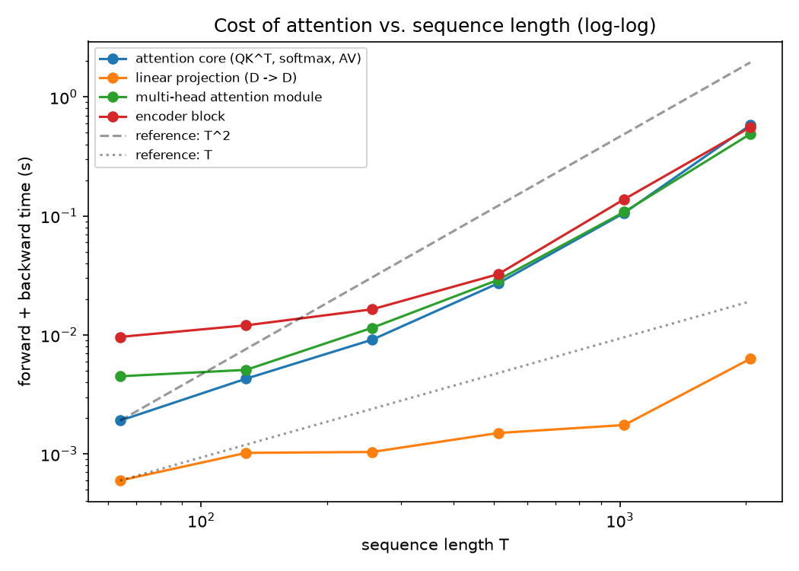

# Experiments report

_Generated on 2026-10-20 from the JSON files in `reports/`._

How to read the numbers:

- Experiments 1 and 2 use a smaller model and less data than the full model of phase 5, so their accuracies are **not comparable** with its 82.1%; compare the variants only with each other.
- Dev and test have 436 sentences each, so one accuracy has a standard error of about 2 points. Differences below the seed-to-seed std are not established.
- Timings are CPU measurements on one machine: read growth rates and orders of magnitude, not absolute values.

## Experiment 1: number of heads

_Not run yet (`reports/exp1_heads.json` not found)._

## Experiment 2: removing positional encoding

Setup: d_model=64, heads=4, d_ff=256, layers=2, subset=20000, epochs=4, syn_train=6000, syn_epochs=30, seeds=[0, 1, 2].

### Synthetic task (label = 1 iff marker A comes before marker B; chance = 50%)

| Variant | Test acc % (mean ± std) | mean abs(p(original) - p(A,B swapped)) |
|---|:-:|:-:|
| with PE | 100.0 ± 0.0 | 9.98e-01 |
| without PE | 49.2 ± 0.9 | 1.19e-08 |

### SST-2

_Not run in this experiment file._

**Analysis (write your own):** what did you see, is it larger than the noise, and why?

## Experiment 3: sequence length and attention cost

Setup: batch=2, d_model=64, heads=4, repeats=5.

| T | Attention matrix (MB) | Core forward (ms) | Core fwd+bwd (ms) | x vs previous T |
|---:|---:|---:|---:|---:|
| 64 | 0.12 | 0.49 | 1.91 | - |
| 128 | 0.50 | 0.87 | 4.29 | 2.25 |
| 256 | 2.00 | 3.07 | 9.12 | 2.13 |
| 512 | 8.00 | 10.12 | 27.17 | 2.98 |
| 1024 | 32.00 | 32.03 | 106.07 | 3.90 |
| 2048 | 128.00 | 187.86 | 581.11 | 5.48 |

_The matrix size is the theoretical size of the attention-weights tensor (B·H·T²·4 bytes), not measured process memory._

Log-log slope of forward+backward time (1 = linear, 2 = quadratic):

| Component | All points | Last 3 points |
|---|:-:|:-:|
| attention core (QK^T, softmax, AV) | 1.62 | 2.21 |
| linear projection (D -> D) | 0.57 | 1.04 |
| multi-head attention module | 1.38 | 2.04 |
| encoder block | 1.17 | 2.05 |

**Analysis (write your own):** what did you see, is it larger than the noise, and why?
